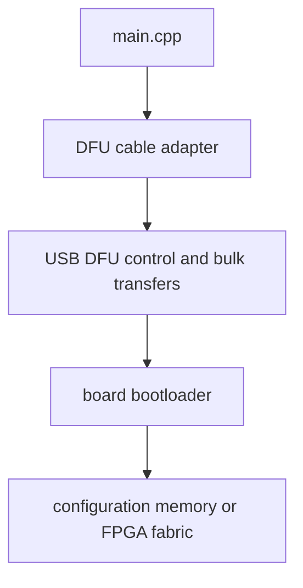

# How it works: direct SPI, DFU, and XVC

Three execution paths avoid the normal JTAG chain scan. They exist for
boards whose hardware makes a JTAG chain impossible, inconvenient, or
unnecessary.

## Direct SPI

### When it is used

Some boards route the programmer's GPIO pins **directly to the configuration
flash**, bypassing the FPGA entirely — typical for iCE40 dev boards, and
available for Efinix and GateMate hardware. The board catalog marks these
with communication mode `COMM_SPI` (or you force it with `--spi` on an
FTDI cable).

### How it works

- No TAP, no IDCODE, no chain. The FPGA is not involved at all — the board
  simply powers up from whatever is in the flash afterwards.
- The `SPIFlash` engine is identical to the JTAG-backed one: JEDEC ID,
  protection, erase, page-write, verify. Only the byte transport differs
  (FTDI bit-banged or MPSSE SPI instead of JTAG scans).
- Because there is no identification step, the `-b`/`-c` choice matters
  more: the board entry carries the SPI pin mapping (CS/SCK/MOSI/MISO,
  optionally HOLDn/WPn). If detection fails, check the pins, not the FPGA.

> **Note**
> Direct SPI cannot program SRAM. For iCE40, the `.bin` from nextntr/pnr
> is written straight to the flash.

## DFU

### When it is used

Boards with a **USB bootloader** that speaks the DFU (Device Firmware
Upgrade) protocol: ULX3S and ULX4M (LD/LS), OrbTrace, and similar. The
board is held in DFU mode (usually a button at power-up) and presents itself
as a USB DFU device — no JTAG hardware at all.

### How it works

- Selected by `--dfu` or a `COMM_DFU` board entry (the board catalog
  supplies the USB VID/PID and the DFU alternate setting; `--altsetting`
  overrides the latter).
- The DFU adapter owns the USB class protocol: detach, download
  transactions, status polls. It is a *different transport contract* from
  the JTAG interface — it does not shift bits and does not scan chains.
- The bootloader is responsible for placing the received image into the
  FPGA's configuration memory or fabric.

## XVC (Xilinx Virtual Cable)

XVC transports JTAG scan operations over TCP/IP (default port 3721,
`--port`). openFPGALoader implements both ends:

### XVC client

`-c xvc-client --ip <host> [--port N]` makes a *remote* endpoint look like a
local `JtagInterface` to the normal JTAG engine. Everything else — chain
detection, vendor dispatch, flash — behaves exactly as with a physical
cable; only the bit transport crosses the network.

### XVC server

When built with XVC server support, openFPGALoader can *host* the server:
it accepts remote XVC requests and routes them through a **local** cable
adapter. This is how a lab machine with the physical cable serves remote
clients.

## Remote bitbang and SVF

Two more non-physical transports are worth knowing:

- **Remote bitbang** (`remoteBitbang_client`) drives JTAG from the
  OpenOCD `remote_bitbang` JTAG driver over TCP — useful when the GPIOs
  live on another machine.
- **SVF playback** (`svf_jtag`, and SVF input files for several vendors)
  executes a recorded IEEE 1149.1 SVF script — the vendor's own
  characterization/programming script — bit by bit through any JTAG
  transport.

## Related: MCU JTAG

Some Xilinx/AMD SoCs expose a microcontroller (ARM) on the same JTAG chain.
`--conmcu` connects the JTAG chain to the MCU instead of the FPGA fabric,
and `--mcufw <file>` programs the MCU firmware. The chain mechanics are
identical; the vendor driver targets a different TAP on the chain.

## Choosing the right path

| Situation | Path |
|---|---|
| Standard dev board with JTAG header | JTAG (default) |
| Board with no JTAG, FTDI wired to flash | direct SPI |
| Board with USB bootloader button | DFU |
| JTAG hardware on another machine | XVC or remote bitbang |
| Vendor-provided SVF script only | SVF |
| Programming the MCU on a SoC | JTAG + `--conmcu`/`--mcufw` |

## Further reading

- [Overview](overview.md) — the four paths in context.
- [CLI reference](../guide/cli-reference.md) — the mode options in full.
- [Cable compatibility list](../compatibility/cables.md) — every transport keyword.
