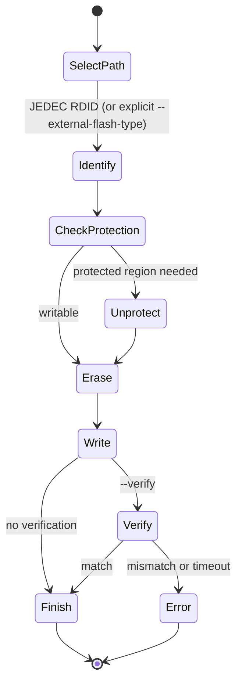

# How it works: flash programming

Flash programming is the non-volatile half of openFPGALoader: erase a
region, write the configuration image, and leave the board bootable. This
page explains the model the tool uses — where flash lives, how the chip is
identified, and the lifecycle every `-f` operation runs through.

## Where the flash lives

The physical location of the configuration flash differs by family, and the
*exposure path* — how the tool reaches it — differs too:

| Exposure path | Who uses it | How it works |
|---|---|---|
| **Direct SPI from the cable** | iCE40 boards, Efinix SPI kits, GateMate SPI | the FTDI (or compatible) pins are wired straight to the flash; no FPGA JTAG at all |
| **Vendor JTAG-to-SPI bypass** | Lattice ECP5/CrossLink-NX/Certus-NX, Efinix Trion/Titanium (JTAG), Anlogic, Cologne Chip, Lattice iCE40 (via board SPI) | the FPGA's own configuration port is exposed on JTAG; the tool issues SPI commands through the JTAG chain |
| **SPI-over-JTAG bridge bitstream** | Xilinx (7-series, Spartan-6/7, UltraScale), Efinix, Altera Cyclone | a small bridge design is loaded into the FPGA SRAM first; it wires the USER JTAG instructions to the board's SPI flash pins |
| **Internal non-volatile memory** | Lattice MachXO2/MachXO3 (NVCM), Gowin (user flash), Altera MAX10 (internal flash) | the FPGA programs its own on-die memory over the vendor configuration protocol — no external SPI flash chip |
| **BPI flash** | some Xilinx Kintex/Artix boards | bidirectional-parallel interface; `BPIFlash` implements it |
| **Altera AS/PS** | Cyclone/Stratix/Arria/Eagle via EPCS/EPCQ | active-serial or passive-serial configuration over the JTAG chain (vendor protocol) |

The key idea: **the vendor driver exposes the flash, the flash engine
programs it.** `SPIFlash`/`BPIFlash` implement generic memory operations;
they do not know whether the bits arrive over FTDI SPI pins or over a JTAG
USER instruction. That separation is what lets one flash database and one
erase/write/verify engine serve every family.

## Identifying the flash: the JEDEC ID

Before writing anything, the tool issues **RDID (0x9F)** and reads 4 bytes:

```text
manufacturer (8 bits) | memory type (8 bits) | capacity (8 bits) | extra (8 bits)
```

Most chips identify with the first three bytes (the 24-bit JEDEC ID, e.g.
`0x20ba19` = Micron 256 Mbit). Some report a 32-bit electronic signature
instead. The ID is looked up in the static flash database
(`src/protocols/spiFlashdb.hpp`), which stores, per chip:

- capacity and sector geometry (number of 64 KiB sectors),
- erase capabilities (4 KiB subsector erase, 64 KiB sector erase, extended
  address register for chips above 16 Mbit),
- protection layout (which register holds the BP/TB bits, how many BP bits,
  whether TB is one-time-programmable),
- quad-mode capability (which register/bit enables it, or none),
- and quirks such as a global lock bit.

> **Note**
> If the ID is unknown, the tool prints the raw bytes, the manufacturer
> name, and a ready-to-paste skeleton entry for `spiFlashdb.hpp` — see
> [adding an SPI flash chip](../development/adding-support/spi-flash-chips.md).
> Dumps and auto-sized operations require a known ID; writes to an unknown
> chip use generic fallback behavior and are the source of several "stuck
> after flash ID" symptoms (see the
> [M25P40 field note](../debug/spartan6-hs3-m25p40-write-stall.md).

Some Xilinx SOJ v1 bridges rewrite the RDID command (0x9F) into Read-Flash-
Parameters (0x5F), so the chip answers with a different ID. Those chips have
*alias* entries in the database keyed on the RFP response.

## The flash lifecycle

Every `-f` write (and most `--dump-flash` reads) follows this state machine:



1. **Select exposure path.** The vendor driver decides: direct SPI, JTAG
   bypass, bridge bitstream, or internal memory. For Xilinx this is where
   the SPI-over-JTAG bridge is loaded — see
   [SPI-over-JTAG bridges](spi-over-jtag.md).
2. **Identify.** Read the JEDEC ID; resolve the model. `--external-flash-type`
   can force a model by JEDEC ID or part name when detection misbehaves.
3. **Protection policy.** Read the status register. If the region to be
   written is block-protected, the tool clears the BP bits (remembering to
   relock at the end when `--protect-flash` semantics require it). Some
   families (e.g. ST M25P) have a one-time-programmable TB bit that the
   tool detects and works around when writing non-zero offsets.
4. **Erase.** Flash can only be written from `1` to `0`, so the target
   region is erased first: 4 KiB subsectors when supported, 64 KiB sectors
   otherwise. `--bulk-erase` erases the whole chip (or, for internal-memory
   families, the whole internal flash — with sector selection via
   `--flash-sector`).
5. **Write.** Data is programmed page by page (256-byte pages) from the
   parsed file at `--offset` (default 0). For internal-memory families the
   equivalent is the vendor's configuration-memory program sequence
   (Lattice ISC for MachXO CFG/UFM pages, MAX10 UFM/CFM, Gowin user flash).
6. **Verify.** With `--verify`, the written region is read back and
   compared.
7. **Finish.** Relock protection if the tool cleared it, then restore the
   FPGA to the requested reset/run state (`-r` controls the final reset).

## Offsets, sizes, and dual flash

- `--offset` (`-o`) selects the start address in the non-volatile memory —
  useful for writing raw data (soft-core firmware, for example) anywhere in
  the flash.
- `--file-size` limits a dump. When omitted (or 0) *and* the flash model is
  known, `--dump-flash` dumps from the offset to the end of the chip
  automatically.
- Some UltraScale boards (KCU105/116, VCU118/128, ...) carry **two** SPI
  flash chips. `--target-flash primary|secondary|both` selects the chip;
  `--secondary-bitstream` supplies the image for the second one. In
  SPIx8 (dual-quad) setups the two `.mcs` images are programmed together.
- `--external-flash` switches a device that has both internal and external
  storage to the external chip; `--user-flash` programs Gowin's separate
  user flash area.

## Erase granularity and what `--flash-sector` means

The sector vocabulary is family-specific:

| Family | Erase units |
|---|---|
| External SPI NOR | 4 KiB subsectors / 64 KiB sectors / full chip |
| Lattice MachXO2/3 | internal CFG and UFM page areas, plus FEATURE row and SRAM — `--flash-sector CFG|UFM|FEATURE|SRAM|ALL` |
| Altera MAX10 | internal `CFM0..CFM2` (configuration) and `UFM0..UFM1` (user) — comma-separated `--flash-sector` list |
| Xilinx XCF PROM | full array (can take over a minute); per-array unlock during the sequence |

> **Warning**
> `--flash-sector ALL` on Lattice MachXO2/MachXO3 erases the **feature
> row** as well as the bitstream. A blank feature row can make the board
> look "bricked" (generic JTAG device, `JTAG-NOP`) even though the chip is
> fine. See the [recovery field note](../debug/machxo3-recovery-after-bulk-erase.md)

## Quad mode

`--enable-quad`/`--disable-quad` control quad-I/O operation on the external
SPI flash. It requires a flash with a quad-enable bit (recorded in the
database), a bridge/cable that can drive four data lines, and a board
wired for it — some boards (e.g. Alchitry) have a flash that cannot do
quad at all, and the bitstream must be generated with a matching bus width.
When in doubt, single-wire mode is the safest; the bundled SPI-over-JTAG
bridges are single-wire for maximum compatibility.

## Verifying what happened

Useful confirmation points in a normal log:

```text
JEDEC ID: 0x20ba19
Detected: Micron MT25QL256ABA 512 sectors size: 32Mb
Read flash status: DONE
Erase Flash: [====...] 100.00%
Writing:      [====...] 100.00%
```

If the run ends before `Erase Flash`, the flash was never identified or
unprotected. If it ends inside `Writing`, suspect timing, the bridge
(exposure path), or a wrong sector map. `--dump-flash` followed by a
second run comparing the file is the ground truth.

## Further reading

- [SPI-over-JTAG bridges](spi-over-jtag.md) — the exposure path that needs the most explanation.
- [Adding an SPI flash chip](../development/adding-support/spi-flash-chips.md) — the flash database, field by field.
- [Adding FPGA, flash, and board support](../development/adding-support/fpga-and-flash.md) — all modification points.
- Field notes: [SOJ v2 RDID alignment](../debug/soj-v2-rdid-alignment.md), [MachXO3 recovery](../debug/machxo3-recovery-after-bulk-erase.md) [M25P40 write stall](../debug/spartan6-hs3-m25p40-write-stall.md)
