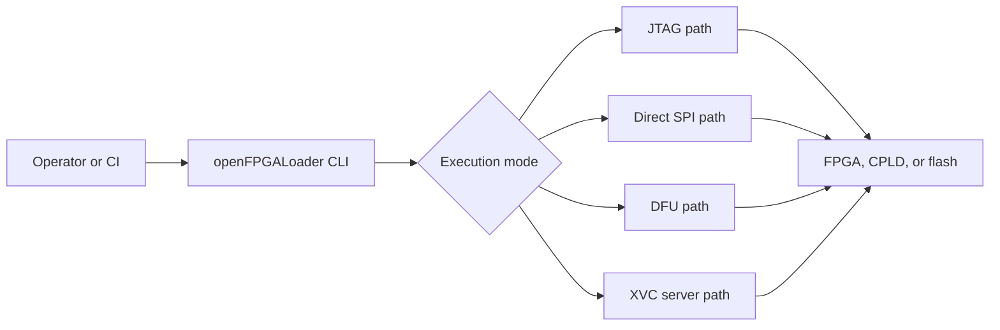
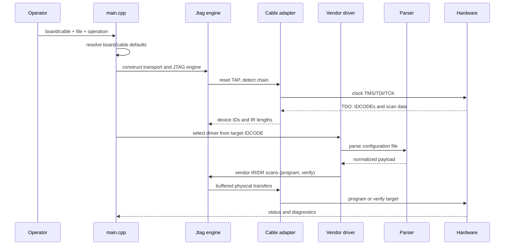

# How it works: overview

This section is the **theory of operation** for openFPGALoader. It explains
what the program does to your board, step by step, from the moment you run a
command until the FPGA is configured. It is written for two readers:

- **operators** who want to understand *what the tool is doing* before they
  trust it with their hardware, and
- **developers** who want to know which part of the system owns which
  behavior before they change it.

For maintainer-level details (source files, contracts, build gates), continue
with the [development architecture section](../development/architecture/overview.md).

## The three memories of an FPGA

Programming an FPGA means writing a configuration image into one of several
kinds of memory. Which one you target determines the command-line flags:

| Memory | Where | Volatile? | Flag |
|---|---|---|---|
| **SRAM** (the fabric itself) | inside the FPGA | yes — gone on power-off or reset | `-m` (the default) |
| **SPI configuration flash** | external chip on the board, or behind a JTAG bridge | no | `-f` |
| **Internal non-volatile memory** | inside the FPGA (Lattice NVCM, Gowin user flash, Altera MAX10 internal flash) | no | `-f` or vendor-specific options |
| **BPI flash** | external bidirectional-parallel chip (some Xilinx boards) | no | `-f` (board-defined) |

Loading SRAM is fast and takes effect immediately, but the design disappears
the next time the board is powered. Writing flash is slower because the tool
must erase, program, and often verify a memory chip, but it is what boots the
board on power-up.

> **Note**
> When a file is a valid bitstream for *both* SRAM load and flash write,
> openFPGALoader defaults to SRAM (`-m`). Pass `-f` explicitly to write
> flash.

## One command, four execution paths

`src/main.cpp` makes the first dispatch decision. A request enters exactly
one of four paths:

| Path | Selected by | Requires | Explained in |
|---|---|---|---|
| JTAG | the default; any `-b`/`-c` JTAG board or cable | a JTAG chain that the cable can reset and scan | [JTAG transport](jtag-transport.md) |
| Direct SPI | `--spi`, or a board whose communication mode is `COMM_SPI` | FTDI (or compatible) pins wired to the flash | [Direct SPI, DFU, and XVC](alternate-paths.md) |
| DFU | `--dfu`, or a `COMM_DFU` board | a USB DFU bootloader on the board | [Direct SPI, DFU, and XVC](alternate-paths.md) |
| XVC | `--xvc` (client) or compiled XVC server mode | a TCP/IP endpoint speaking the XVC protocol | [Direct SPI, DFU, and XVC](alternate-paths.md) |

Everything below — flash algorithms, vendor drivers, parsers — hangs off
these paths.

## The JTAG request lifecycle

The common programming path is a pipeline with a clear owner at each stage:

Stage by stage:

1. **Option parsing.** `main.cpp` turns the command line into an
   `arguments` structure: the selected board or cable, the file and its
   type, the operation (`WR_SRAM`, `WR_FLASH`, `RD_FLASH`), frequencies,
   and overrides.
2. **Catalog resolution.** A board name is looked up in the static board
   catalog (`src/utils/board.hpp`), which supplies the cable, FPGA part,
   pins, communication mode, and flash metadata. A cable name is looked up
   in `src/utils/cable.hpp`. Explicit command-line options always win over
   catalog defaults.
3. **Transport construction.** The `Jtag` engine (`src/protocols/jtag.cpp`)
   builds the matching cable adapter from `src/cables/` — FTDI MPSSE,
   Xilinx Platform Cable USB/FX2, CMSIS-DAP, J-Link, DFU, bitbang, XVC
   client, and so on.
4. **Chain detection.** The TAP is reset and the chain is scanned: every
   device shifts out a 32-bit IDCODE, and the scanner continues until it
   sees the all-ones terminator. See [JTAG transport](jtag-transport.md)
   for the details, including BYPASS padding and multi-device chains.
5. **Vendor dispatch.** The IDCODE of the selected target is mapped through
   the part catalog (`src/utils/part.hpp`) to a vendor class in
   `src/vendors/` — Xilinx, Lattice, Gowin, Altera/Intel, Efinix, Anlogic,
   or Cologne Chip.
6. **File parsing.** The file extension (or `--file-type`) selects a parser
   from `src/parsers/` and vendor-specific parsers: raw, Intel HEX, MCS,
   JEDEC, POF, Xilinx `.bit`/`.bin`/`.map`, Gowin `.fs`, Efinix `.hex`,
   Anlogic `.bit`, Lattice JEDEC, and friends. The parser only transforms
   data — it never touches hardware.
7. **Programming.** For SRAM the vendor driver issues its configuration
   instruction sequence. For flash, the driver first *exposes* the flash
   (direct SPI, JTAG-to-SPI bypass, or an SPI-over-JTAG bridge bitstream —
   see [SPI-over-JTAG bridges](spi-over-jtag.md)) and then runs the generic
   flash lifecycle: identify, unprotect, erase, write, verify, relock,
   reset. See [Flash programming](flash-programming.md).
8. **Reporting.** Progress, IDCODEs, flash model, and errors are reported
   through the display layer; the process exit code reflects success.

## Static catalogs and runtime assets

Two things about this product are easy to misunderstand:

- **Support is compiled in, not discovered.** Boards, cables, FPGA parts,
  and flash models are static C++ catalogs. `--list-boards`,
  `--list-cables`, and `--list-fpga` report exactly what was compiled into
  this binary, and CMake feature flags decide what that is. A source file
  existing in the tree does not guarantee that a given package supports it.
- **Runtime assets are installed data, not code.** SPI-over-JTAG and
  BPI-over-JTAG bridge bitstreams, Spartan-6 ISE `.cor` bridges, and Xilinx
  Platform Cable USB firmware are files installed beside the binary
  (under `share/openFPGALoader/`). The binary finds them through a
  configured data directory, overridable with `OPENFPGALOADER_SOJ_DIR`.
  An archive missing these files is an incomplete deployment.

## Where failures usually live

When a run fails, the stage at which it fails tells you where to look. The
decision tree in the [visual guide](../development/architecture/visual-guide.md)
covers this in depth; the short version:

| Symptom | Likely stage |
|---|---|
| No cable found, permission error | transport construction / OS driver / udev |
| `JTAG init failed`, no IDCODE | TAP reset, clocking, wiring, or cable transport |
| Wrong/missing device in the chain | chain interpretation, `--index-chain`, BYPASS padding |
| "Unsupported device" | IDCODE not in `part.hpp`, or feature flag disabled at build time |
| File rejected, wrong size | parser (format, compression, byte order) |
| `Read ID failed`, erase/write hang | flash exposure (bridge!) or flash model/protection |
| "bridge not found" | runtime data directory / packaging |

## Further reading

- [JTAG transport](jtag-transport.md) — TAP, IDCODE, chains, BYPASS, adapters.
- [Flash programming](flash-programming.md) — JEDEC IDs, erase/write/verify, protection.
- [SPI-over-JTAG bridges](spi-over-jtag.md) — the bridge bitstream that gives Xilinx/Efinix/Altera flash access.
- [Direct SPI, DFU, and XVC](alternate-paths.md) — the non-JTAG paths.
- [Architecture overview](../development/architecture/overview.md) — the same system from the maintainer's side.
