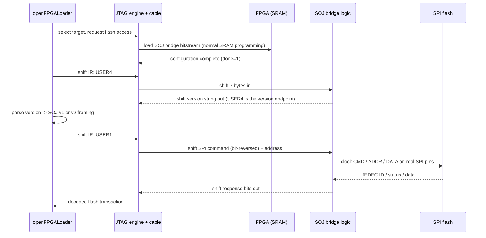

# How it works: SPI-over-JTAG (SOJ) bridges

Many FPGAs cannot reach their own configuration flash over JTAG: the
boundary-scan port is not wired to the SPI flash pins. openFPGALoader solves
this with a **bridge**: a tiny FPGA design that *is* loaded into the target's
SRAM first, and that connects the JTAG **USER** instructions to the board's
SPI flash pins. Once the bridge is running, the tool talks to the flash by
shifting SPI commands and data through the JTAG chain.

This page explains how that works and what to check when it fails.

## Why a bridge is needed

| Family | Flash access over JTAG |
|---|---|
| Xilinx 7-series / Spartan-6/7 / UltraScale | **bridge required** (SOJ bitstream) |
| Efinix Trion / Titanium | **bridge required** |
| Altera Cyclone | **bridge required** (`.rbf.gz` bridge) |
| Lattice ECP5 / CrossLink-NX / Certus(-Pro)-NX | internal JTAG-to-SPI bypass — no bridge |
| Lattice iCE40 | direct FTDI-to-SPI on most boards |
| Lattice MachXO2/3 | internal NVCM — no flash chip at all |
| Anlogic, Cologne Chip | internal JTAG-SPI bypass |
| Intel EPCS/EPCQ | vendor AS/PS configuration protocol |

The bridge is a *bitstream*, exactly like an application bitstream, and it is
treated as installed runtime data:

```text
<install>/share/openFPGALoader/
├── spiOverJtag_<part>.bit.gz        # e.g. spiOverJtag_xc7a35tcsg324.bit.gz
├── bpiOverJtag_<part>.bit.gz        # BPI variants
└── from_ise/spartan-6/<model>_spi.cor  # Spartan-6 bridges built with ISE
```

The name must match the target's `device + package` string from the part
catalog. The default data directory can be overridden with the
`OPENFPGALOADER_SOJ_DIR` environment variable, and `--bridge` (CLI: `-B`
also disables auto-detection of the bridge model) can force a specific file.

> **Note**
> The bundled bridges are **single-wire** (MOSI/MISO only) on purpose, for
> maximum board compatibility. Quad-mode flash I/O through a bridge is not
> supported.

## What happens, step by step



1. **Bridge load.** The bridge bitstream is parsed and programmed into SRAM
   exactly like a normal `-m` load. From then on the FPGA *is* the bridge;
   the application design is gone (it can be re-loaded afterwards).
2. **Version probe.** The tool shifts the USER4 instruction and reads a
   short reply. The bundled v2 core returns the ASCII string `"02.00"`; v1
   bridges return a version the tool decodes numerically (or nothing at all,
   which is read as `SOJ version: 1.000000`).
3. **SPI transactions.** Every flash command (RDID 0x9F, READ 0x03/0x13,
   PAGE-PROGRAM 0x02, SECTOR-ERASE 0x20/0xD8, status reads) is translated
   into JTAG scans: the SPI command byte and data bytes are **bit-reversed
   per byte** before shifting (SPI is MSB-first, JTAG DR shifts LSB-first).
4. **Read-back alignment.** Response bits come out of the chain at a phase
   that depends on how many bypass devices sit in front of the target. The
   decoder re-aligns the shifted stream across JTAG bytes before decoding —
   getting this wrong produces "valid-looking but garbage" IDs (the classic
   `0x905d0c88` case, see
   [SOJ v2 RDID alignment](../debug/soj-v2-rdid-alignment.md)).

## SOJ v1 and v2

Two bridge protocol generations coexist:

| | SOJ v1 | SOJ v2 |
|---|---|---|
| Families | 7-series, Spartan-6, Spartan-7 (older bridges) | UltraScale / UltraScale+ / ZynqMP (and newer cores) |
| Framing | one raw bit-reversed byte per SPI byte | packetized: a header byte carries the length, then command+data |
| Version endpoint | USER4, numeric | USER4, ASCII `"02.00\0"` |
| Quirk | some bridges rewrite RDID (0x9F) → RFP (0x5F), so the flash answers with a different ID (alias entries in the flash database) | packets longer than 31 bytes use the extended-length format |

The version is **auto-detected** after every bridge load: the tool probes
USER4, and if the v1 probe fails it falls back to the v2 packet format;
if the first RDID fails, it probes USER1–USER3 in turn (some custom bridges
use a different USER instruction). Detection must never depend on verbose
logging — a bug that made it do exactly that was fixed; see the
[SOJ review](../debug/soj-review.md).

## Spartan-6 `.cor` bridges

Spartan-6 bridges are built with ISE rather than Vivado, and the packaged
variants are ISE `.cor` files under
`src/transport_db/spiOverJtag/from_ise/spartan-6/`. For a Spartan-6 target
the tool first looks for a `.cor` matching the FPGA model and package
(derived from the package suffix), and falls back to
`spiOverJtag_<part>.bit.gz` if none exists.

## When the bridge fails

The failure signature points at the stage:

| Signature | Stage |
|---|---|
| `Open file ... spiOverJtag_*.bit.gz` missing | data directory / packaging — check `OPENFPGALOADER_SOJ_DIR` and the install layout |
| bridge loads (`done 1`) but `SOJ version raw: 00 00 00 ...` or all `ff` | USER scans not returning data: post-configuration startup, USER instruction map for the family, or transport decode — see the [Spartan-6 XPCU investigation](../debug/spartan6-xpcu-spi-investigation.md) |
| version OK, RDID garbage (`0x905d0c88`) | RX alignment / chain shift — see [SOJ v2 RDID alignment](../debug/soj-v2-rdid-alignment.md) |
| version OK, RDID valid but erase/write hangs | flash model missing from the database, protection bits, or bridge timing — see [M25P40 write stall](../debug/spartan6-hs3-m25p40-write-stall.md) |
| `Unknown key HW_TIMEOUT` with a *non-bridge* `.bit` | you passed an application bitstream with `--bridge`; omit the flag so the packaged bridge is selected |

> **Warning**
> Do not confuse a failing *bridge* with a failing *flash*. If the USER4
> version endpoint is dead, the SPI command format is irrelevant — the
> failure is in the bridge or the JTAG framing, not in the flash chip.

## Building bridge bitstreams

Bridges for new parts are built with the toolchain of the target family
(Vivado/ISE, Quartus, Efinity) from the `src/transport_db/spiOverJtag/`
sources. The full procedure — `make` targets, per-package constraint files,
`build.py`/`efinix_build.py` mappings — is documented in
[SPI-over-JTAG bridges (adding new parts)](../development/adding-support/spi-over-jtag-bridges.md).

## Further reading

- [Flash programming](flash-programming.md) — the lifecycle the bridge feeds into.
- [JTAG transport](jtag-transport.md) — USER instructions, BYPASS, alignment.
- [SOJ source review](../debug/soj-review.md) — the audit of the SOJ transport code, findings, and remaining risks.
- [SPI-over-JTAG source README](../development/adding-support/spi-over-jtag-bridges.md) — building and versioning bridges.
